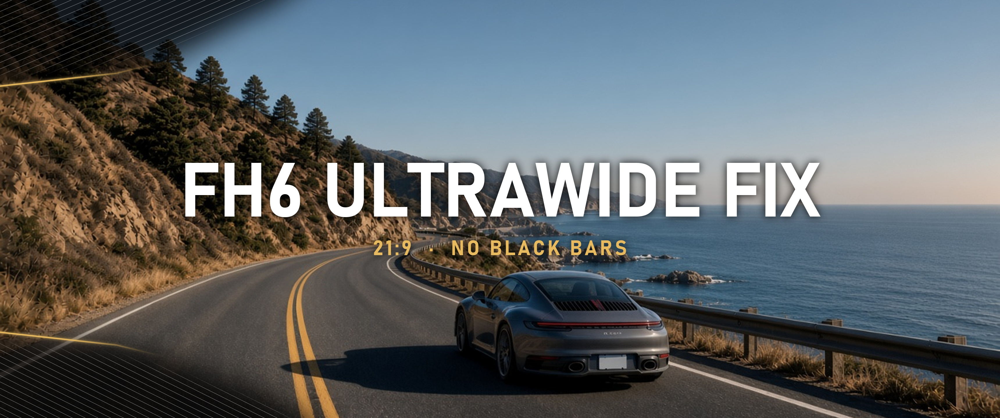
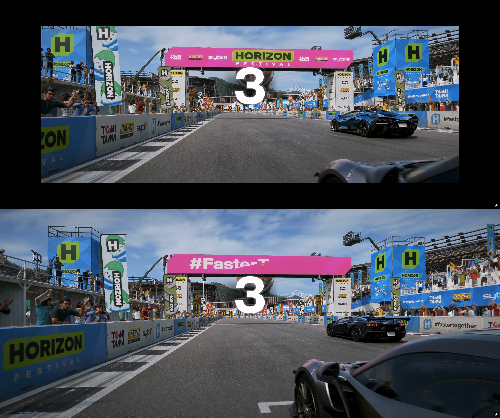
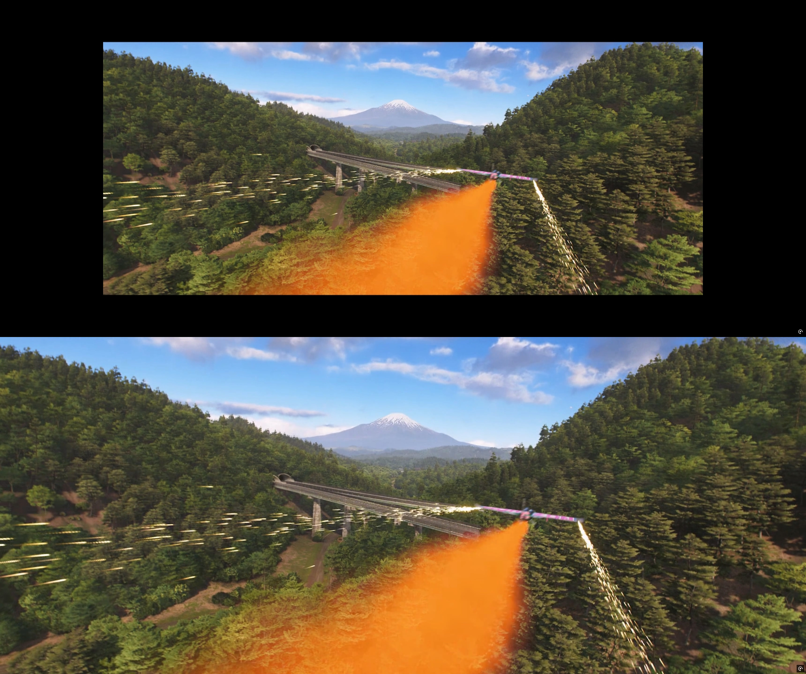
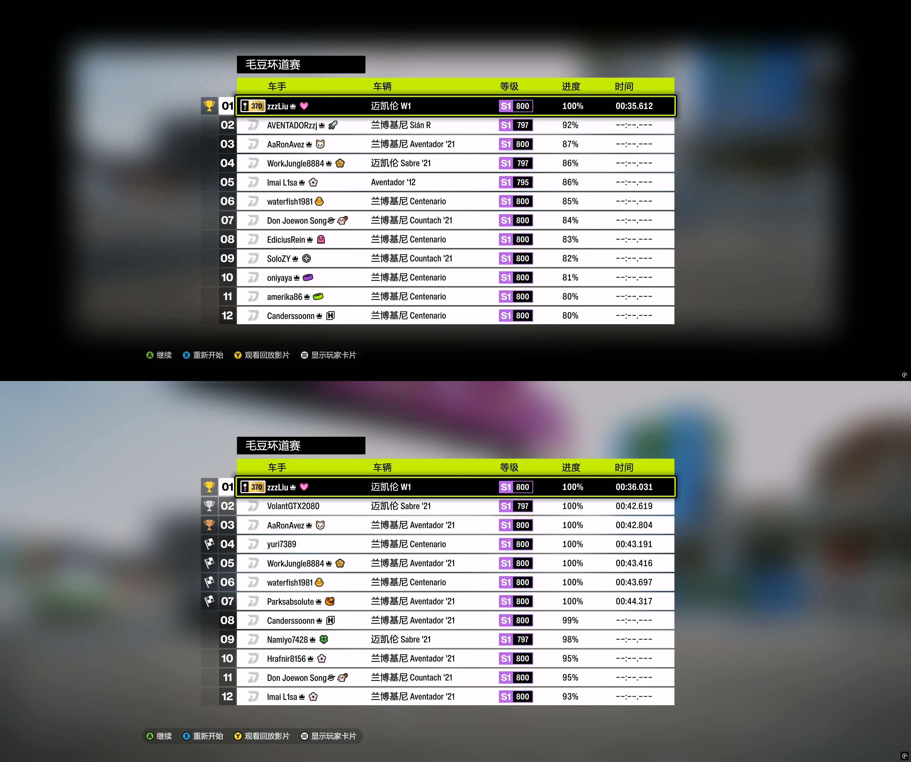
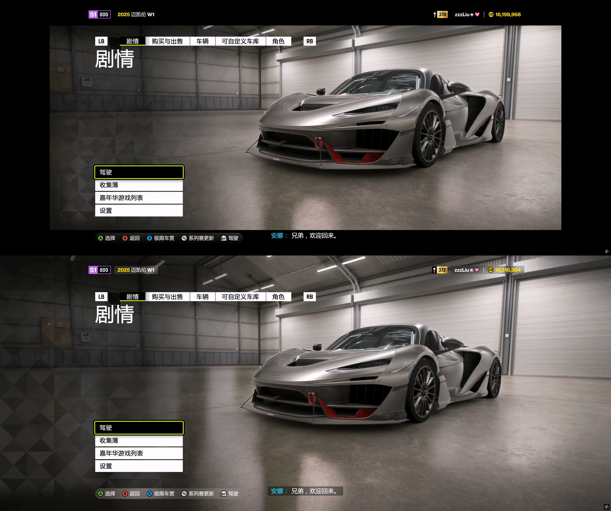
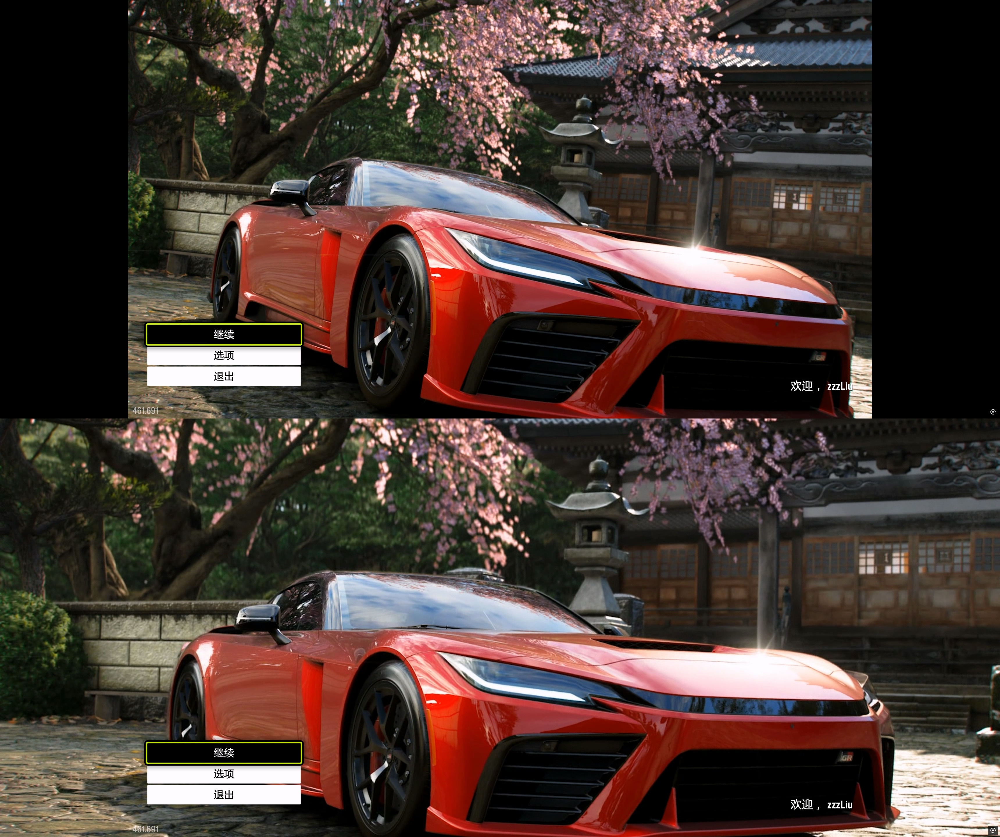
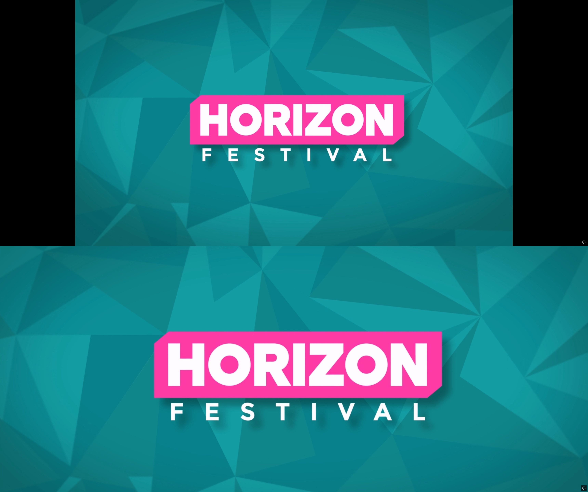
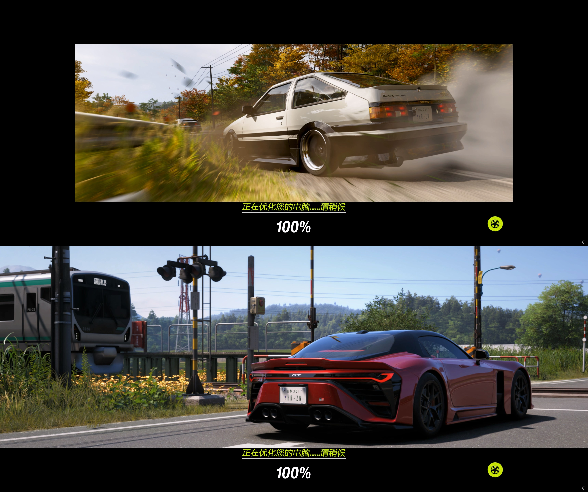

# FH6-Ultrawide-Fix v1.0



[中文](#中文) | [English](#english)

---

## 中文

《极限竞速：地平线 6》(Forza Horizon 6) 的 **21:9 宽屏 mod**，去掉过场动画、加载画面和全屏视频两侧及上下的黑边。在 GitHub 上发布和维护：<https://github.com/zzzLiu/FH6-Ultrawide-Fix>

### 安装

1. 下载发布包里的 zip。
2. Steam：打开有 `forzahorizon6.exe` 的文件夹，把 zip 里的 `mediapc` 文件夹直接拖进去。
3. 微软商店 / Xbox 应用：放进 Content 文件夹。放完是 `Forza Horizon 6\Content\mediapc`。

提示合并时选择合并 / 替换。

本 mod 只在 `mediapc` 覆盖目录里放文件，不修改游戏本体。游戏更新后，如果过场或界面出现异常，先卸载本 mod 看是否恢复，并留意本项目是否有更新版本。

本 mod 有 875 个文件。它和其他 mod 会不会冲突，我无法逐一确认，请自行判断。两个 mod 改到同一个文件时，后安装的会覆盖先安装的。安装前请先备份游戏目录里已有的 `mediapc` 文件夹。

！！！这是一个美化 mod，只修改 UI 界面，没有改动平衡性相关的内容。我自己安装了这个 mod，在线上游玩没有被封号，但这不能保证使用它一定不会被封号。请自行斟酌，风险自负。

### 测试与改动

- 只在 **3440×1440（21:9）** 下测试过。
- 其他分辨率没有测试，**不保证效果**。
- 比 21:9 更宽的屏幕（如 32:9）**不保证效果**，作者没有更宽的显示器，无法测试。

所有放大都是**等比放大**，不会拉伸变形。对比图上方是原版，下方是本 mod。

**游戏内实时过场**（车库、购车、出发、赛前、倒计时、终点、自由漫游开场等）

去掉过场的遮幅黑边。



**全屏剧情视频**（表演赛开场、冲刺赛开场、剧情片段）

等比放大铺满。素材本身带上下黑条，放大后裁掉的基本只是黑条，画面上下各损失不到 1%。



**季节切换动画**

等比放大到铺满宽度。保留原片的超宽画幅，上下保留片子自带的细黑边，画面完整无裁切。

**赛后名次画面**

装饰背景等比放大铺满全屏，文字位置不变。



**车库主菜单左侧格子**

格子图等比放大约 1.45 倍，并左移到贴齐 3440×1440 的屏幕左边缘。菜单文字不动。



**游戏启动后的标题画面**（“开始游戏”那一页）

16:9 视频等比放大铺满，上下各裁掉约 13%。Logo 和菜单文字位置不变；按开始后的黑场过渡也改为全屏。



**Horizon Festival 加载动画**

16:9 动画等比放大铺满，上下各裁掉约 13%。



**普通加载画面**（快速移动等）

背景图 / 视频等比放大铺满宽度，底部保留黑色区域显示加载提示和统计文字。素材上下各裁掉约 3%。



### mod 包含的文件 / 卸载

一共 875 个文件。完整列表在安装目录的 `mediapc\FH6-Ultrawide-Fix-files.txt`，仓库里的副本是 [`mod/mediapc/FH6-Ultrawide-Fix-files.txt`](mod/mediapc/FH6-Ultrawide-Fix-files.txt)。

```
mediapc\FH6-Ultrawide-Fix-files.txt
mediapc\UI\Scenes\Anthem\A_DestinationMenu.xaml
mediapc\UI\Scenes\Anthem\A_InitialDriveSeasonTransitionFMV.xaml
mediapc\UI\Scenes\Anthem\A_MotionGraphics.xaml
mediapc\UI\Scenes\Anthem\A_PostRaceFinishLine.xaml
mediapc\UI\Scenes\Anthem\A_Splash.xaml
mediapc\UI\Scenes\Anthem\A_VideoPlayer.xaml
mediapc\UI\Scenes\Anthem\Loading.xaml
mediapc\Cinematics\   （867 个 .xml，整个文件夹）
```

**卸载：**删除 `mediapc\FH6-Ultrawide-Fix-files.txt`、上面 7 个 `.xaml` 文件，以及 `mediapc\Cinematics` 文件夹。游戏会自动改回读取原版文件。

- 如果你的 `mediapc\Cinematics` 里还有其他 mod 的文件，请对照 `mediapc\FH6-Ultrawide-Fix-files.txt` 只删除本 mod 的文件。删完后把这个清单文件也一起删掉。
- `mediapc\UI` 里的其他文件不属于本 mod，不要删。

---

## English

A **21:9 ultrawide mod** for Forza Horizon 6. Removes the black bars around cinematics, loading screens and full-screen videos. Published and maintained on GitHub: <https://github.com/zzzLiu/FH6-Ultrawide-Fix>

### Install

1. Download the zip from Releases.
2. Steam: open the folder containing `forzahorizon6.exe` and drag the `mediapc` folder from the zip into it.
3. Microsoft Store / Xbox app: put it in the Content folder. The result is `Forza Horizon 6\Content\mediapc`.

Choose merge / replace if prompted.

This mod only adds files to the `mediapc` override folder; game files are not modified. If cutscenes or menus misbehave after a game update, uninstall this mod first to check, and look for an updated version here.

This mod is 875 files. I can't check it against every other mod, so judge conflicts for yourself. If two mods edit the same file, the one installed last wins. Back up any existing `mediapc` folder before installing.

!!! This is a cosmetic mod. It only changes the UI, and does not touch balance. I play online with this mod installed and have not been banned for it. That is not a guarantee you won't be banned. Decide for yourself, and use it at your own risk.

### Testing and changes

- Tested **only at 3440×1440 (21:9)**.
- Other resolutions are untested and **not guaranteed** to work.
- Screens wider than 21:9 (e.g. 32:9) are **not guaranteed**; I don't have a wider monitor to test on.

All scaling is **uniform** (no stretching). In each comparison, the original is on top and this mod is below.

**In-engine cutscenes** (garage, car purchase, departure, pre-race, countdown, finish line, free-roam intros, etc.)

Letterbox / pillarbox bars removed.


**Full-screen story videos** (Showcase intros, Rush intros, story clips)

Scaled up to fill. The videos have black bars baked in at the top and bottom, so the crop removes almost only those bars; less than 1% of the picture lost at top and bottom.


**Season change videos**

Scaled to fill the width. The original extra-wide framing is kept, including its thin baked-in bars at top and bottom; nothing cropped.

**Post-race results screen**

Decorative background scaled to fill the screen; text unchanged.


**Garage menu lattice on the left**

Scaled uniformly by about 1.45 and shifted so it meets the left edge at 3440×1440. Menu text stays put.


**Title screen after launch** (“Start Game” page)

16:9 video scaled to fill, about 13% cropped at top and bottom. Logo and menu unchanged; the fade-to-black after pressing Start now covers the full screen.


**Horizon Festival loading animation**

16:9 animation scaled to fill, about 13% cropped at top and bottom.


**Regular loading screens** (fast travel, etc.)

Background image / video scaled to the full width; a black strip is kept at the bottom for the loading hints and stats. About 3% cropped at top and bottom.


### Files / uninstall

875 files in total. The full list ships in the install as `mediapc\FH6-Ultrawide-Fix-files.txt`. The copy in this repo is [`mod/mediapc/FH6-Ultrawide-Fix-files.txt`](mod/mediapc/FH6-Ultrawide-Fix-files.txt).

```
mediapc\FH6-Ultrawide-Fix-files.txt
mediapc\UI\Scenes\Anthem\A_DestinationMenu.xaml
mediapc\UI\Scenes\Anthem\A_InitialDriveSeasonTransitionFMV.xaml
mediapc\UI\Scenes\Anthem\A_MotionGraphics.xaml
mediapc\UI\Scenes\Anthem\A_PostRaceFinishLine.xaml
mediapc\UI\Scenes\Anthem\A_Splash.xaml
mediapc\UI\Scenes\Anthem\A_VideoPlayer.xaml
mediapc\UI\Scenes\Anthem\Loading.xaml
mediapc\Cinematics\   (867 .xml files, the whole folder)
```

**Uninstall:** delete `mediapc\FH6-Ultrawide-Fix-files.txt`, the 7 `.xaml` files above, and the `mediapc\Cinematics` folder. The game falls back to its original files.

- If `mediapc\Cinematics` also contains files from other mods, use `mediapc\FH6-Ultrawide-Fix-files.txt` to delete only this mod's files, then delete that list too.
- Other files under `mediapc\UI` are not part of this mod; leave them alone.

---

## 捐赠 / Support

<a href="https://ko-fi.com/zzzliu"></a>

https://ko-fi.com/zzzliu


微信赞赏码

---

### For maintainers / 维护

```powershell
.\tools\build-release.ps1                   # rebuild the file list and dist\FH6-Ultrawide-Fix-v1.0.zip
.\tools\toggle-mod.ps1 off|on|status       # temporarily disable / re-enable the installed mod (for comparisons)
```
